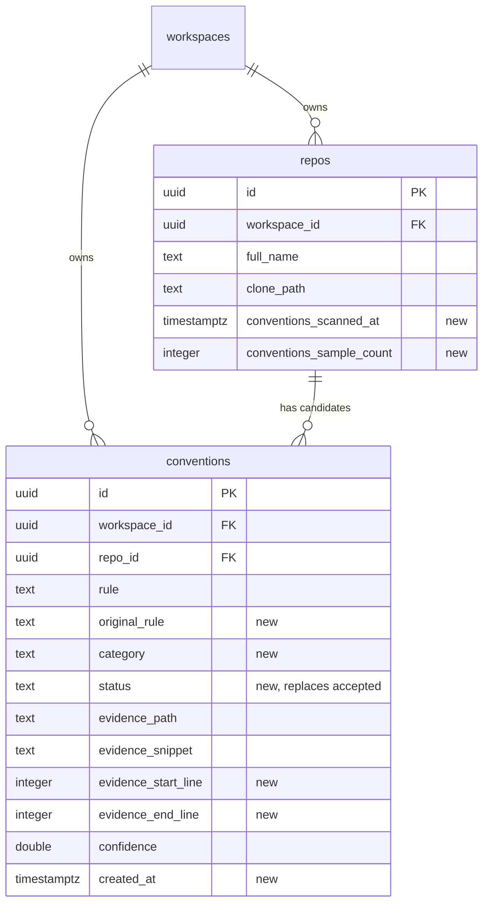

# Data model — conventions-extractor

> Mode: brownfield delta. Sources: [spec](./spec.md) §5, [sad](./sad.md) §5/§6/§8,
> [ADR-0001](./adr/0001-replace-accepted-flag-with-review-status.md). Conventions followed from
> `server/src/db/schema/*.ts` and `server/src/db/migrations/` (drizzle-kit). Staged SQL lives in
> [`migrations/`](./migrations/) — **not** in the live tree; `implement` promotes it.

## Repo conventions (detected, followed)

| Topic | Repo convention | Applied here |
|---|---|---|
| Schema source | Drizzle TS schema in `server/src/db/schema/*.ts`; live SQL generated by `drizzle-kit generate` with a snapshot in `migrations/meta/` | the staged SQL is the reviewed target; `implement` edits the TS schema, runs `pnpm db:generate`, and checks the generated file against it (then hand-adds the backfill) |
| Naming | snake_case columns, `<table>_<cols>_idx` btree indexes | same |
| PK | `uuid` `defaultRandom()` | unchanged (no new table) |
| Audit | `created_at timestamptz NOT NULL DEFAULT now()` via `now()` helper; no `updated_at` on most tables | `conventions.created_at` added the same way |
| Enums | `text` with a Drizzle `enum` option — validated in the app, **no DB CHECK** anywhere in the repo | `status` is `text NOT NULL DEFAULT 'pending'`, values enforced by Drizzle/Zod (ADR-0001 «constrained» = app-level) |
| Nullability | evidence columns on `conventions` are nullable | new evidence/category columns nullable; contract makes them required for new rows |
| Index form | plain `CREATE INDEX … USING btree` inside drizzle's migration transaction; no `CONCURRENTLY` | same (`conventions` is small; no feature writes it yet) |
| Down migrations | none in the repo | staged `.down.sql` provided for review/rollback only |

## ER diagram

Skills tables are **unchanged**: `updated_at` in the `Skill` contract (ADR-0002) is derived from
`max(skill_versions.created_at)` per skill, served by the existing `skill_versions` primary key
(`skill_id`, `version`); `evidence_files` already exists on `skills`.

## Entities

### `conventions` (aggregate root: `repos`)

| Column | Type | Constraints | Notes |
|---|---|---|---|
| `id` | uuid | PK, `defaultRandom()` | existing |
| `workspace_id` | uuid | NOT NULL, FK → `workspaces(id)` ON DELETE cascade | existing; **index added** |
| `repo_id` | uuid | FK → `repos(id)` ON DELETE cascade | existing (nullable); **index added** |
| `rule` | text | NOT NULL | existing; current (possibly edited) text, 1–1000 chars (contract) |
| `original_rule` | text | nullable | **new**; the model's proposed text, written once at insert, never updated (AC-13, AC-14) |
| `category` | text | nullable | **new**; 1–40 chars (contract) (AC-06, AC-15) |
| `status` | text | NOT NULL DEFAULT `'pending'` | **new**; `pending \| accepted \| rejected` (app enum) — replaces `accepted` (ADR-0001) |
| `accepted` | boolean | — | **dropped** after backfill |
| `evidence_path` | text | nullable | existing |
| `evidence_snippet` | text | nullable | existing |
| `evidence_start_line` | integer | nullable | **new**; 1-based first line of the fragment's first occurrence (AC-05) |
| `evidence_end_line` | integer | nullable | **new** |
| `confidence` | double precision | nullable | existing; 0–1 |
| `created_at` | timestamptz | NOT NULL DEFAULT now() | **new**; stable ordering within a run |

**Access patterns:** list by repo (flow 3) · delete pending by repo + insert new in one
transaction (flows 1, 5) · read accepted + rejected by repo for the do-not-repeat list (flow 6) ·
update one by id within workspace (flow 4) · cascade delete by workspace.

### `repos` (root) — new columns only

| Column | Type | Constraints | Notes |
|---|---|---|---|
| `conventions_scanned_at` | timestamptz | nullable | **new**; time of the last *successful* run (AC-03, AC-06) |
| `conventions_sample_count` | integer | nullable | **new**; sample files analysed by that run, style configs not counted (AC-06) |

Null on both = never scanned (AC-07 empty state).

## Indexes

| Index | Columns | Query it serves |
|---|---|---|
| `conventions_repo_status_idx` | (`repo_id`, `status`) | list a repo's candidates (flow 3); delete the repo's `pending` rows on re-scan (flows 1, 5); read the repo's `accepted`/`rejected` rows for the do-not-repeat list (flow 6); also serves the `repo_id` FK cascade |
| `conventions_ws_idx` | (`workspace_id`) | FK index for the workspace cascade delete (repo convention, cf. `0011_fk_indexes`) |

Single-candidate updates (flow 4) use the primary key; the workspace check is a filter on the
fetched row. No other index is justified.

## Migrations (staged)

| Ordinal | Files | What |
|---|---|---|
| 01 | `01_expand_conventions_review_status.{up,down}.sql` | add `status`, `original_rule`, `category`, evidence lines, `created_at`; add repo scan facts; add both indexes |
| 02 | `02_backfill_conventions_status.{up,down}.sql` | `status` from `accepted`; `original_rule` from `rule` |
| 03 | `03_contract_conventions_accepted.{up,down}.sql` | drop `accepted` |

Expand → backfill → contract, per the zero-downtime rule. DevDigest deploys as one local process,
so `implement` may promote all three into a **single** generated drizzle migration (`0014_…`) in
this order; the split keeps the backfill reviewable.

## Test fixtures

Not in migrations — the repo builds fixtures in test code:

- `MockLLMProvider({ structuredBySchema: { ConventionExtraction: … } })` — one fixture per scenario
  (valid, partly invalid per AC-03b, traversal path, credential fragment, repeat of a decided rule,
  > 20 candidates).
- A small insert helper in `server/test/` for candidates with a given `status` / `original_rule`
  (pattern of existing service tests); clone fixtures as temp dirs with LF and CRLF files.
- Fake credentials built at runtime (`sk-ant-${'a1B2'.repeat(8)}`), never literal (root
  INSIGHTS: pr-self-review secret rule). No PII: authors in fixtures are `Test User`,
  `user-<uuid>@example.test`.
