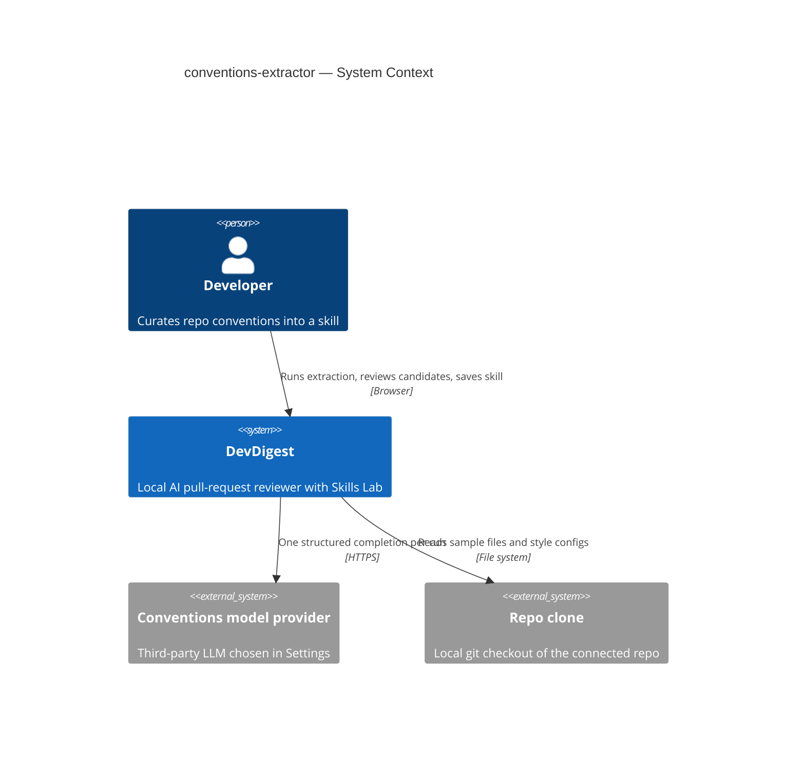
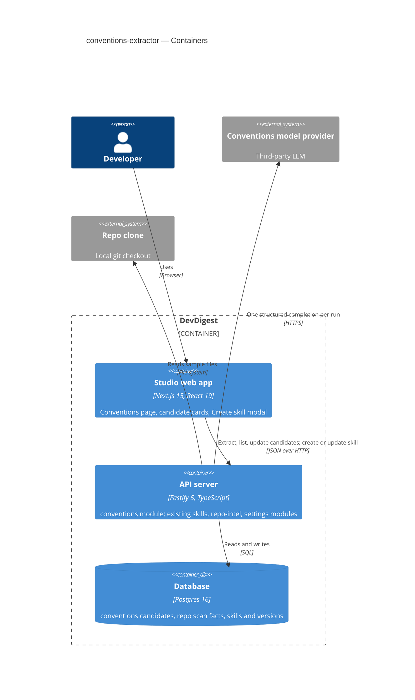
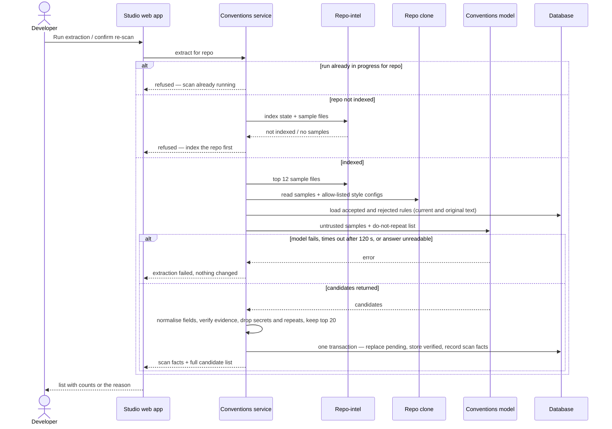
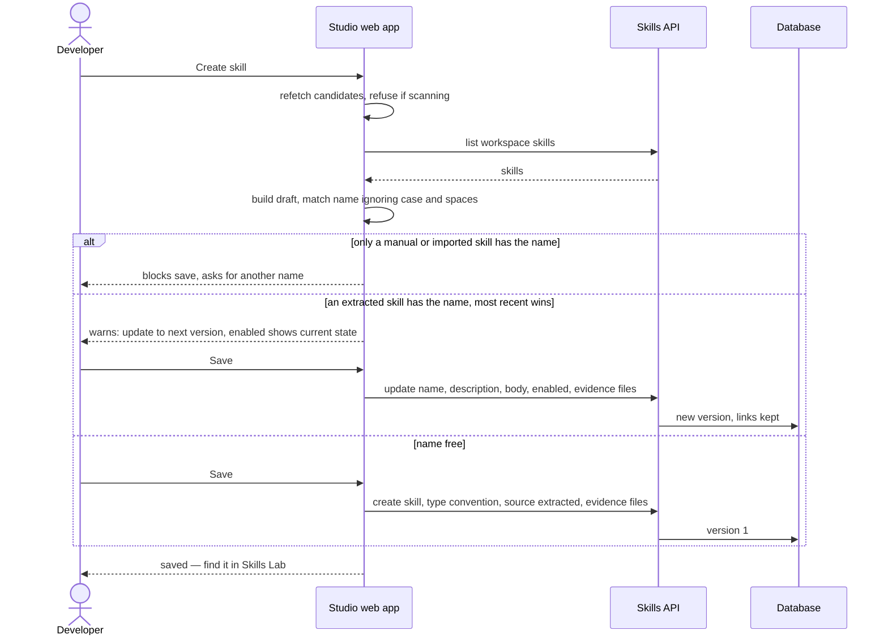
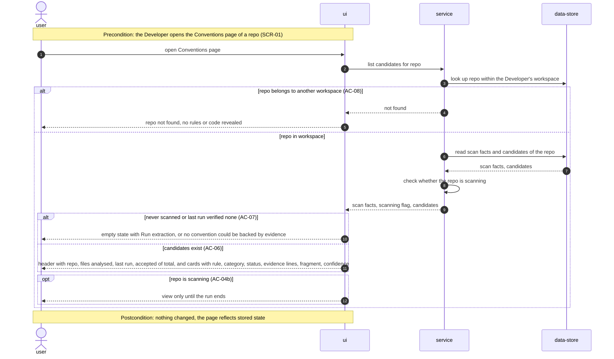
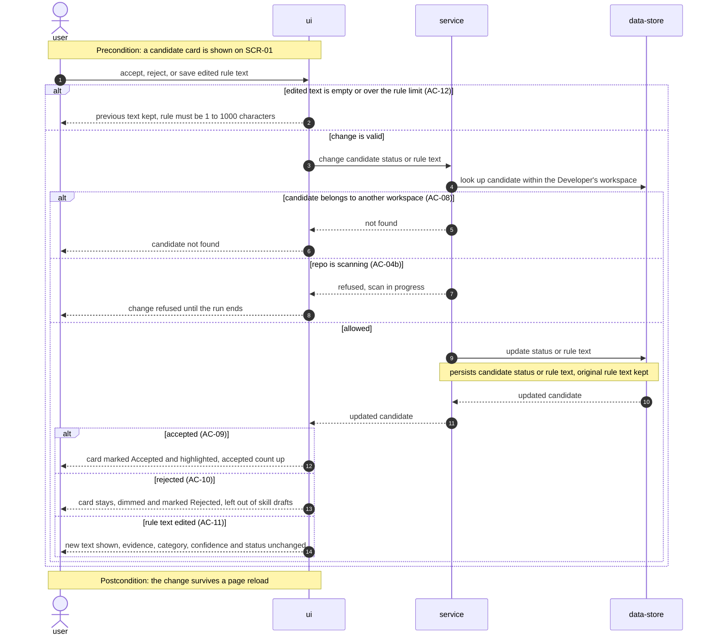
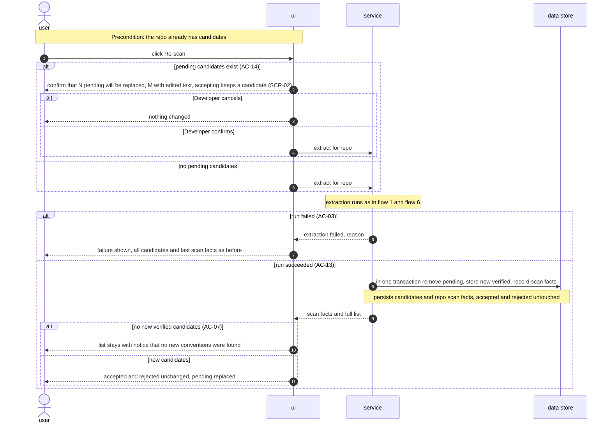
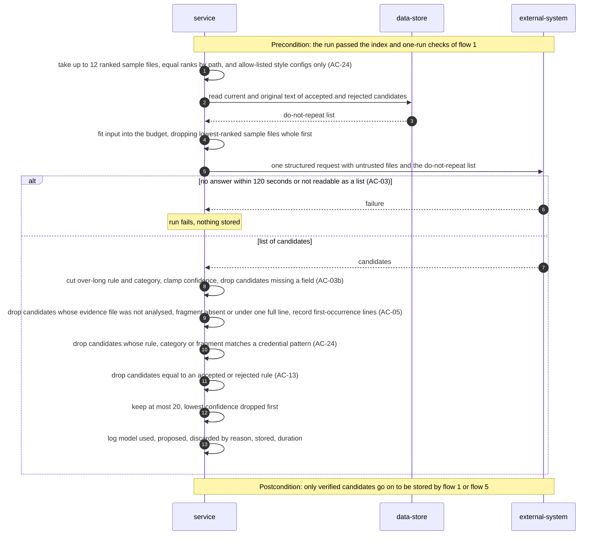
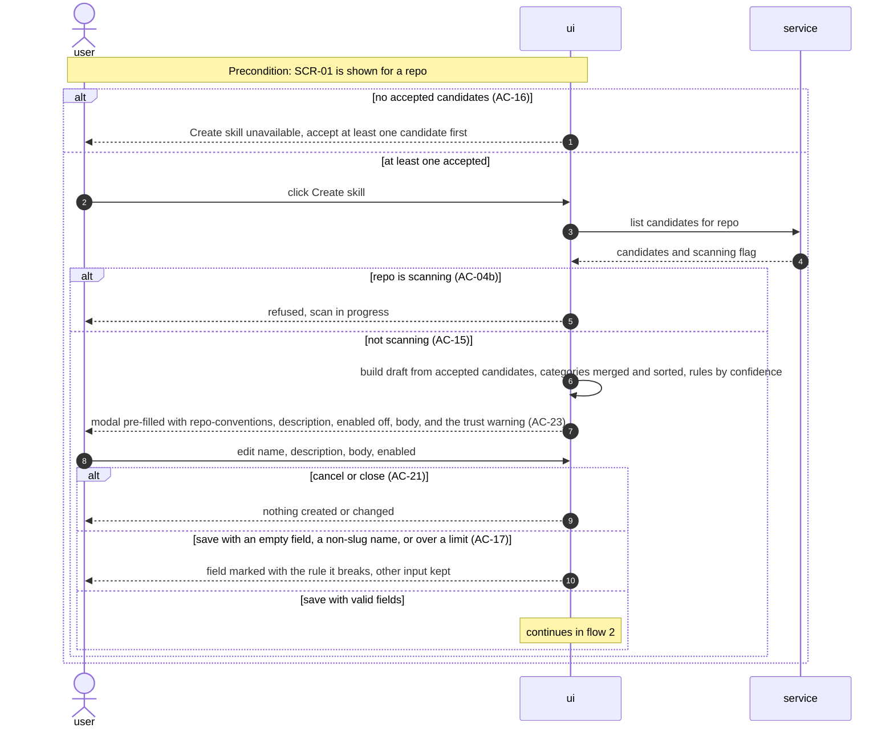
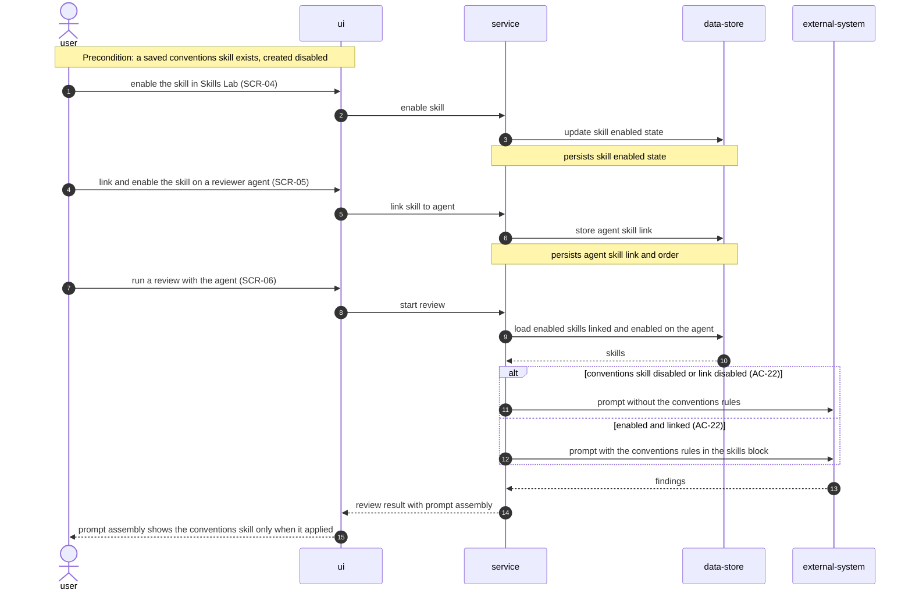

# Software Architecture Document — conventions-extractor

> Inputs: [spec](./spec.md) (after clarify) · [glossary](./CONTEXT.md) · [ux-flows](./ux-flows.md) (SCR-01 … SCR-06). Depth: easy (quick route) — convention
> defaults were decided from the repo and confirmed as one batch; only blast-radius decisions
> were asked. No `docs/architecture-map.md` exists; the brownfield was mapped by a read-only
> explorer pass (2026-11-26).

## 1. Introduction and goals

**Intent.** Give the Developer a code-grounded draft of a repo's conventions: one extraction run
samples the repo, asks the cheap conventions model once, keeps only candidates whose evidence is
verified against the clone, and lets the Developer accept, reject or rewrite each one and turn
the accepted ones into a `convention` skill through the existing skills mechanism (spec §1–§2).

**Top-3 quality goals (full scenarios in §10):**

1. **Grounding** — every stored candidate carries verified evidence; nothing unverified reaches the Developer.
2. **Safety of the trust boundary** — repo content stays untrusted until a human accepts it; no secret is stored; no file outside the analysed sample is read.
3. **Bounded cost and latency** — one model call per run, capped input, ≤ 20 stored candidates, one run per repo at a time, p95 ≤ 90 s.

**Stakeholders.**

| Role | Interest | Sign-off owner? |
|---|---|---|
| Developer | runs extraction, curates candidates, saves the conventions skill | No |
| Reviewer agent | receives the conventions skill as instructions once linked | No |
| Tech Lead | SAD approval, layering, migration | Yes |
| Security Lead | trust-laundering and secret-handling controls (spec §6.1) | Yes |

<!-- Decision overrides (¶4) — none. -->

## 2. Constraints

**Technical.**
- Node ≥ 22, TypeScript 5.x, Zod 3.25 (not v4); vitest 2.
- Server: Fastify 5, Drizzle ORM, Postgres 16 (+ pgvector, unused here); migrations via `drizzle-kit generate` into `server/src/db/migrations/` (latest `0013_skills_phase2`).
- Client: Next.js 15 App Router, React 19, TanStack Query, next-intl 3; UI primitives only from `client/src/vendor/ui` (`kit/Modal` exists).
- LLM calls go through the `LLMProvider` adapters (`completeStructured` with a Zod schema + `schemaName`); the model is resolved per feature with `resolveFeatureModel(workspaceId, 'conventions')`.
- Repo files are read only through `readClone` → `readContainedFile` (realpath containment, regular files, 2 MiB cap).
- Sample selection: `repoIntel.getConventionSamples(repoId, 12)` (returns `[]` when repo-intel is off or the repo is not indexed; equal ranks must be ordered by path — spec §6 determinism); index status via `repoIntel.getIndexState(repoId)`.
- Skills API today: create accepts `source` `manual | imported` only, no `evidence_files`, no name uniqueness; the `Skill` contract has no update timestamp.

**Organisational.**
- Size S, route quick; single developer; lab milestone on branch `lab-02`.

**Conventions.**
- Backend: onion layering per `.claude/skills/onion-architecture` (domain / application / infrastructure / http per module; composition in `platform/container.ts`; registration in `modules/index.ts`); workspace from `getContext(container, req)`; not-found as a domain error mapped to 404.
- Contracts: `server/src/vendor/shared` is the source of truth; `client/src/vendor/shared` must stay byte-identical (`scripts/check-contracts.sh`).
- Client: page composes only; logic in colocated `_components/<Name>/`; data only via `lib/hooks/*`; all strings in `messages/<locale>/` (`conventions.json` exists); `src/vendor/**` changes only as a sync (the sidebar entry lives in `vendor/ui/nav.ts`).
- Everything written in English.

**Regulatory / external.**
- Secrets never go into the DB, git or logs (root CLAUDE.md) — drives the secret filter (§8).
- Repo content is sent to the configured third-party model provider, as reviews already do.

## 3. Context and scope

DevDigest runs locally for one Developer per workspace. The extractor reads the local clone of a
connected repo and its code index, calls the conventions model chosen in Settings, stores
candidates in the local database, and hands curated rules to the existing skills feature. The
trust boundary sits at the model call: everything from the repo and everything the model returns
is untrusted until verified by code and accepted by the Developer.

<!-- brownfield: onion modules under server/src/modules (skills, agents, repos, repo-intel, settings …); conventions table exists without behaviour; client has /repos/[repoId]/pulls only; no per-repo lock pattern; no skill-name uniqueness. -->

**External systems (in / out):**

| Actor or system | Type | Interaction |
|---|---|---|
| Developer | Person | runs extraction, curates candidates, saves and links the skill |
| Conventions model provider (OpenAI / Anthropic / OpenRouter) | System (external) | one structured completion per run; receives sampled repo text |
| Repo clone on local disk | System (internal) | source files and style configs, read-only |
| Reviewer agent run | System (internal) | consumes the saved skill through the existing prompt assembly |

**C4 Context (L1):**



## 4. Solution strategy

**Target surfaces:** `backend-service` (the existing Fastify API) + `web-frontend` (the existing
Next.js studio). No new deployable. UI architecture is inherited, not decided here: App Router
page that only composes, client components for the page and modal, TanStack Query hooks for data.

**Top strategic choices:**

1. **Verify in code, curate by a human** — the model only *proposes*; deterministic code checks
   each candidate against the clone (file in sample, fragment present, ≥ 1 full line, no
   credential pattern, not a repeat) before anything is stored, and nothing becomes an instruction
   until the Developer accepts it and saves a skill that starts disabled. Serves quality goals 1–2.
2. **Extend the existing candidate table with an explicit review status** — status
   `pending | accepted | rejected` replaces the boolean, plus category, evidence line range and
   the originally proposed rule text, and per-repo last-scan facts; no new table (→ [ADR-0001](./adr/0001-replace-accepted-flag-with-review-status.md)).
3. **Assemble the skill in the client, save through the public skills API** — the conventions
   module never writes skills; the modal builds the body from accepted candidates and creates or
   updates the skill through the existing skills routes, which learn to accept source `extracted`
   and `evidence_files`, and expose `updated_at` (resolves spec §8 «extend the skills capability»)
   (→ [ADR-0002](./adr/0002-assemble-conventions-skill-in-client-via-skills-api.md)).
4. **Synchronous extraction with an in-process per-repo guard** — the run is one request that
   returns the new list; a process-local set refuses a second run for the same repo and puts its
   candidates in read-only mode (spec AC-04b); the model call is aborted after 120 s; a server
   restart clears the set, so no repo stays «scanning»
   (→ [ADR-0003](./adr/0003-run-extraction-synchronously-with-in-process-repo-guard.md)).

## 5. Building block view

The server side is a new onion module that depends inward on its own domain and outward only
through ports wired in the container (repo-intel, LLM provider + feature-model resolver, clone
reader, conventions repository). It never touches the skills module. The client side is a new
page under the repo route plus one hook file; the skill modal talks to the existing skills hooks.

**Internal decomposition:**

```
server/src/modules/conventions/
├── domain/
│   ├── types.ts            ConventionCandidateEntity, CandidateStatus, ExtractionInput
│   ├── errors.ts           RepoNotIndexed, ExtractionInProgress, ExtractionFailed, CandidateNotFound
│   ├── policies.ts         limits (12 files, 400 lines, 40k tokens, 20 stored, 120 s), style-config allow-list
│   ├── normalize.ts        pure: lenient per-candidate parse — cut rule/category, clamp confidence, drop incomplete
│   ├── verify-evidence.ts  pure: in analysed set, normalised fragment match, ≥1 full line, first-occurrence range
│   ├── secret-filter.ts    pure: credential patterns over rule, category, fragment (copy of pr-self-review list)
│   ├── dedupe.ts           pure: normalised match against current + original text of accepted/rejected
│   └── ports.ts            ConventionsRepository, SampleSource, ExtractionModel
├── application/
│   └── conventions.service.ts  extract(), list() (+ scanning flag), updateCandidate() (refused while scanning)
├── infrastructure/
│   ├── conventions.repository.ts   Drizzle: candidates + repos scan facts, replace-pending tx
│   └── extraction-model.ts         prompt build (wrapUntrusted), completeStructured('ConventionExtraction'),
│                                   loose schema, abort at 120 s
├── http/
│   ├── routes.ts           extract · list · patch candidate
│   └── schemas.ts
└── index.ts                factory + registerConventionsRoutes

server/src/modules/skills/   create accepts source 'extracted'; create/update accept evidence_files;
                             list returns updated_at (latest version time); version kinds unchanged
server/src/adapters/mocks.ts drop the two-step 'ConventionFileSelection' note — one schema per run
server/src/vendor/shared/contracts/knowledge.ts (+ client copy)
    ConventionCandidate: accepted → status; + category, evidence_start_line, evidence_end_line, original_rule
    ConventionScan: sample_count, scanned_at · ConventionList: { scan, scanning, candidates }
    Skill: + updated_at (optional)

client/src/app/repos/[repoId]/conventions/
├── page.tsx                composes ConventionsView
└── _components/
    ├── ConventionsView/    header (scan facts, N of M accepted, Re-scan, Create skill), empty state (SCR-01)
    ├── CandidateCard/      rule (inline edit), category, status badge, evidence, confidence, Accept/Reject
    ├── RescanConfirm/      kit/Modal — N pending replaced, M edited texts lost (SCR-02)
    └── CreateSkillModal/   kit/Modal; name (slug rule, modal only)/description/enabled/body; trust + update warnings (SCR-03)
    helpers.ts              buildSkillDraft(accepted, repo) — pure; categories merged case-insensitively, A–Z,
                            rules by confidence desc; findExtractedMatch(skills, name)
client/src/lib/hooks/conventions.ts   list / extract / patch (+ uses hooks/skills.ts for save)
client/src/vendor/ui/nav.ts           SKILLS LAB → Conventions (/repos/:repoId/conventions) — vendored sync
```

**C4 Container (L2):**



## 6. Runtime view

**Critical flow 1: extraction run (first scan and re-scan)**



**Critical flow 2: assemble and save the conventions skill**



### Flow 3: view candidates (US-02)



### Flow 4: accept, reject or edit a candidate (US-03, US-04)



### Flow 5: re-scan with confirmation (US-05)



### Flow 6: candidate screening inside a run (US-01, US-02, US-05)



### Flow 7: open and edit the skill draft (US-06, US-07)



### Flow 8: apply the conventions in a review (US-08)



**Coverage (sequences, 2026-11-26).**

| User story | Flows |
|---|---|
| US-01 Run extraction | 1, 6 |
| US-02 Review candidates | 3, 6 |
| US-03 Accept or reject | 4 |
| US-04 Edit rule text | 4 |
| US-05 Re-scan | 5, 1, 6 |
| US-06 Assemble skill | 7, 2 |
| US-07 Save or discard | 2, 7 |
| US-08 Apply in reviews | 8 |

| AC | Shown in | AC | Shown in |
|---|---|---|---|
| AC-01 | flow 1 happy path | AC-13 | flow 5 success branch; flow 6 repeat drop |
| AC-02 | flow 1 «not indexed» branch | AC-14 | flow 5 confirm / cancel branches |
| AC-03 | flow 1, 5, 6 failure branches | AC-15 | flow 7 «not scanning» branch |
| AC-03b | flow 6 normalise step | AC-16 | flow 7 «no accepted» branch |
| AC-04 | flow 1 «run in progress» branch | AC-17 | flow 7 invalid-save branch |
| AC-04b | flow 3 opt, flow 4 and flow 7 «scanning» branches | AC-18 | flow 2 «name free» branch |
| AC-05 | flow 6 verification step | AC-19 | flow 2 «extracted match» branch |
| AC-06 | flow 3 «candidates exist» branch | AC-20 | flow 2 «manual or imported only» branch |
| AC-07 | flow 3 empty branch; flow 5 «no new» branch | AC-21 | flow 7 cancel branch |
| AC-08 | flow 3 and flow 4 «another workspace» branches | AC-22 | flow 8 both branches |
| AC-09 | flow 4 accepted branch | AC-23 | flow 7 modal open step |
| AC-10 | flow 4 rejected branch | AC-24 | flow 6 allow-list and credential steps |
| AC-11 | flow 4 edited branch | | |
| AC-12 | flow 4 invalid-text branch | | |

No AC is non-runtime; none is uncovered.

**Flags for design:** none — every participant above maps to a §5 container (ui = Studio web app, service = API server, data-store = Database, external-system = conventions model provider). Flows 1–2 keep their design-stage participant names.

## 7. Deployment view

N/A — reuses the existing local deployment (server :3001, client :3000, Postgres in Docker); one migration, no new process or infrastructure.

## 8. Crosscutting concepts

| Concept | Convention | Where defined |
|---|---|---|
| Untrusted input | sample files and configs enter the prompt via `wrapUntrusted('repo-file:<path>', …)` with the injection guard; model output is parsed by Zod and re-verified in code | reviewer-core `prompt.ts`; here |
| Evidence verification | evidence path must be in this run's analysed set (sample files or allow-listed style configs); fragment matched after normalising whitespace and line endings; must contain ≥ 1 complete non-blank line; line range of the first occurrence | `domain/verify-evidence.ts` |
| Lenient model output | the answer must parse as a list; per candidate, rule text cut to 1000 and category to 40 characters, confidence clamped to 0–1, a candidate missing a required field dropped and counted; ≤ 20 stored, lowest confidence dropped first | `domain/normalize.ts` |
| Scanning state | the in-process set is the single source: the list reports `scanning`; candidate changes are refused with `ExtractionInProgress` while set; the client refetches before opening and before saving the skill modal | conventions service; client |
| Secret handling | allow-listed style configs only (`.eslintrc*`, `eslint.config.*`, `tsconfig*.json`, `.prettierrc*`, `prettier.config.*`, `.editorconfig`, `biome.json`); candidates whose rule text, category or fragment match the credential patterns are dropped; the patterns are a copy of the `pr-self-review` `checks.mjs` list, kept in sync by a server test that reads that file's source (resolves spec §8); fragments never logged | `domain/secret-filter.ts`, `domain/policies.ts` |
| Repeat suppression | current and original text of accepted + rejected candidates sent as a do-not-repeat list; new candidates equal to either after lower-casing and whitespace collapse are dropped | `domain/dedupe.ts` |
| Input budget | ≤ 12 samples, each ≤ 400 lines, total ≤ 40 000 tokens (existing tokenizer adapter); over budget → drop the lowest-ranked sample files whole first, keep the do-not-repeat list whole | `domain/policies.ts` |
| Error handling | domain errors (`RepoNotIndexed`, `ExtractionInProgress`, `ExtractionFailed`, `CandidateNotFound`) mapped centrally to HTTP; client shows plain-language messages from `messages/en/conventions.json` | server `app.ts` error map |
| Authorization | every route resolves `workspaceId` via `getContext`; repo and candidate lookups filter by it; foreign ids → not found | `_shared/context.ts` |
| Logging | one line per run: repo id, model, proposed / discarded (by reason) / stored counts, duration; never fragments | conventions service |
| i18n | all UI strings in `messages/en/conventions.json` (extend with card, modal and warning keys) | client |
| Contracts | change in `server/src/vendor/shared`, then copy to client; CI diff check | root CLAUDE.md |

## 9. Architecture decisions

| # | Title | Status | Section |
|---|---|---|---|
| 0001 | Replace the accepted flag with a review status | Accepted | §4, §5 |
| 0002 | Assemble the conventions skill in the client via the skills API | Accepted | §4, §6 |
| 0003 | Run extraction synchronously with an in-process repo guard | Accepted | §4, §6 |

ADR files live under `docs/features/conventions-extractor/adr/NNNN-<title>.md`.

## 10. Quality requirements

**QG-1. Grounding**
- **When:** the model returns candidates whose evidence path is outside the sample, whose fragment is absent, differs only by whitespace/CRLF, or is a single keyword.
- **Then:** 100 % of stored candidates have verified evidence; whitespace-only differences still verify; partial-line fragments are dropped.
- **How verify:** unit tests of `verify-evidence.ts` over fixtures (LF/CRLF, out-of-sample path, `../` path, one-token fragment); service test with `MockLLMProvider.structuredBySchema['ConventionExtraction']` asserting only verified rows are stored.

**QG-2. Safety of the trust boundary**
- **When:** a sample contains a planted instruction or a credential, or the model names a path outside the clone.
- **Then:** repo text reaches the model only inside `<untrusted>` blocks; no candidate whose rule text, category or fragment matches a credential pattern is stored; no file outside the sample is read; a new conventions skill is created disabled.
- **How verify:** prompt-assembly unit test; secret-filter tests with built-at-runtime fake keys; verification test with traversal paths; client test that the modal defaults enabled off for a new skill and shows the trust warning.

**QG-3. Bounded cost and latency**
- **When:** a Developer runs extraction, or starts a second run for the same repo while one is in flight.
- **Then:** exactly 1 model call per run; ≤ 12 sample files + allow-listed style configs, each truncated to ≤ 400 lines, total input ≤ 40 000 tokens; ≤ 20 stored, lowest confidence discarded first; ≤ 1 extraction run per repo at a time; the same repo state and index produce the same sample set; extraction run duration p95 ≤ 90 s; candidate list load p95 ≤ 300 ms for ≤ 50 candidates; accept / reject / edit p95 ≤ 300 ms.
- **How verify:** mock call count in the service test; budget unit test; concurrent-request test expecting one refusal; per-run duration from the run log line.

## 11. Risks and technical debt

| Risk / debt | Severity | Mitigation | Owner |
|---|---|---|---|
| Trust laundering: a planted repo comment becomes an accepted rule that tells agents to skip a class of problems | High | untrusted wrapping; human acceptance; skill created disabled; modal trust warning (spec AC-23) | Security Lead |
| Name-clash rule and update-vs-create are enforced only in the client (ADR-0002) — another client or a direct API call can create duplicate names or overwrite an extracted skill | Medium | single local user; the skills API still validates fields and versions every update (history restorable); revisit if skills get server-side name uniqueness | Tech Lead |
| «Read-only while scanning» (AC-04b) is enforced on the server for candidate changes, but for the skill save only by a client refetch (ADR-0002) — a tab that saves during a scan can still save | Low | refetch before opening and before saving the modal; the skill reads only accepted candidates, which a scan never changes | Tech Lead |
| Sample read races with a repo sync that rewrites the clone mid-run | Low | evidence is verified against the same read buffers sent to the model, not re-read later | Tech Lead |
| Synchronous request can exceed a proxy or browser timeout on slow models | Low | p95 target 90 s; local app without a proxy; ADR-0003 names the job-runner fallback | Tech Lead |
| `vendor/ui/nav.ts` is a vendored copy — adding the Conventions item must follow the vendored-sync rule | Low | change it in the same PR and note it in the PR description | Tech Lead |

**Accepted debt (acceptable in v1, plan to fix later):**
- Category labels are free text from the model, not normalised across runs.
- Accepted candidates are never re-verified after the code changes.
- Credential patterns are a copy of the self-review list, not a shared module; they can drift.

## 12. Glossary

| Term | Meaning |
|---|---|
| Convention candidate | a proposed rule with category, verified evidence, confidence and a review status — see [CONTEXT](./CONTEXT.md) |
| Review status | `pending` (undecided), `accepted`, `rejected`; only pending candidates are replaced by a re-scan |
| Sample set | the ≤ 12 ranked source files + allow-listed style configs read in one run; evidence must come from it |
| Do-not-repeat list | accepted + rejected rule texts sent to the model on a re-scan |
| Scan facts | per-repo time of the last successful extraction and its sample-file count (style configs not counted) |
| Original rule | the rule text as the model proposed it; kept when the Developer edits the rule, used for repeat suppression and the edited-count in the re-scan confirmation |
| Conventions skill | a `convention`-type, `extracted`-source skill assembled from accepted candidates, default name `repo-conventions` |
