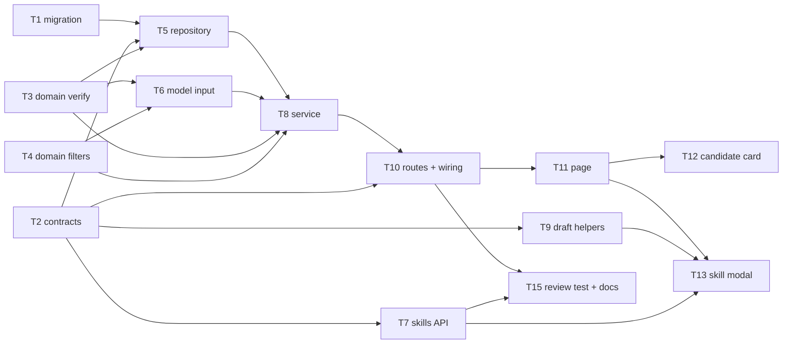

# Epic — conventions-extractor

> **Spec:** [spec.md](../spec.md) · **Design:** [sad.md](../sad.md) · **Data model:** [data-model.md](../data-model.md) · **API:** [openapi.yaml](../contracts/openapi.yaml) · **Screens:** [screens.md](../screens.md) · **ADRs:** [adr/](../adr/)

## Goal

A Developer runs one extraction on a repo, gets candidate conventions each backed by verified
evidence from the code, curates them (accept, reject, edit), and saves the accepted ones as a
`convention` skill that reviewer agents use once linked (spec §2). Grounding, the trust boundary
and bounded cost are the three quality goals (sad §1).

## Scope

- **In:** migration on `conventions` + `repos` (staged 01–03); vendored contracts; a new onion
  module `server/src/modules/conventions`; a small extension of the skills API (`extracted` source,
  `evidence_files`, `updated_at`); the Conventions page, candidate card, re-scan confirmation and
  Create skill modal; the sidebar entry; tests and the server README API map.
- **Out:** learning from PR history; exporting rule files; repo-scoped skills; re-verifying
  accepted candidates; background extraction; a curated category list (spec §3).

## Task map

Waves: 1 — T1, T2, T3, T4 · 2 — T5, T6, T7, T9 · 3 — T8 · 4 — T10 · 5 — T11, T15 · 6 — T12, T13
(one lane: both touch `conventions.json`).

## Tasks

See [tracker.md](./tracker.md) for status. Machine contract: [tasks.json](../tasks.json).

| # | Task | Layer | Blocked by | DoD (short) |
|---|---|---|---|---|
| T1 | [Promote the conventions review-status migration](./t01-promote-conventions-migration.md) | migration | — | 0014 generated, backfill inserted, applies on fresh + populated DB |
| T2 | [Update the conventions and skill contracts](./t02-update-shared-contracts.md) | domain | — | both copies identical, typecheck green |
| T3 | [Conventions domain: verification](./t03-conventions-domain-verification.md) | domain | — | normalize + verify-evidence unit tests |
| T4 | [Conventions domain: filters and limits](./t04-conventions-domain-filters.md) | domain | — | secret filter + sync test, dedupe, limits |
| T5 | [Conventions repository](./t05-conventions-repository.md) | infra | T1, T2, T3 | replace-pending transaction tests |
| T6 | [Extraction input and model call](./t06-extraction-input-and-model.md) | infra | T3, T4 | sample set, budget, untrusted wrap, 120 s abort |
| T7 | [Skills API for extracted skills](./t07-skills-api-extracted-source.md) | app | T2 | extracted source, evidence_files, updated_at |
| T8 | [Conventions service](./t08-conventions-service.md) | app | T3, T4, T5, T6 | guard, failures, run log |
| T9 | [Skill draft helpers](./t09-skill-draft-helpers.md) | ui | T2 | grouping, ordering, name match |
| T10 | [Conventions routes and wiring](./t10-conventions-routes-and-wiring.md) | ports | T2, T8 | contract responses, DOMAIN_STATUS |
| T11 | [Conventions page](./t11-conventions-page.md) | ui | T10 | SCR-01 page states, SCR-02, sidebar |
| T12 | [Candidate card](./t12-candidate-card.md) | ui | T11 | card states, EvidenceSnippet |
| T13 | [Create skill modal](./t13-create-skill-modal.md) | ui | T7, T9, T11 | SCR-03 states |
| T15 | [Review integration + docs](./t15-review-integration-and-docs.md) | tests | T7, T10 | skill in prompt assembly, README |

## Risks / Hard rules

- Only verified candidates are ever stored; evidence must come from this run's analysed files (spec AC-05, sad §8).
- Repo text reaches the model only inside `<untrusted>` blocks; no credential is shown or stored (spec AC-24, §6.1).
- Exactly one model call per run, ≤ 40 000 input tokens, ≤ 20 stored, ≤ 1 run per repo at a time (spec §6).
- A new conventions skill is created disabled; the modal shows the trust warning (spec AC-15, AC-23).
- Staged migrations are promoted by T1 only; the vendored contracts change in both copies together (root CLAUDE.md); `vendor/ui/nav.ts` changes only as a noted vendored change (sad §11).
- «No skill save while scanning» is client-enforced only (ADR-0002, sad §11).
