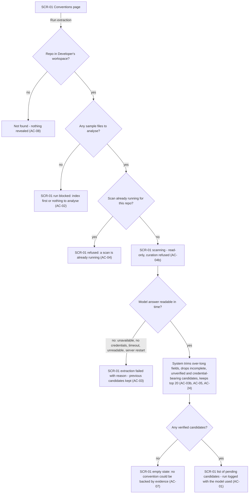
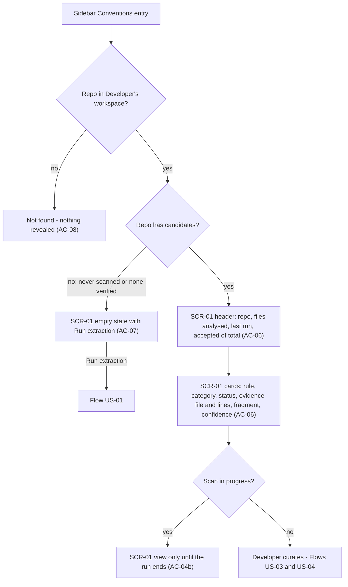
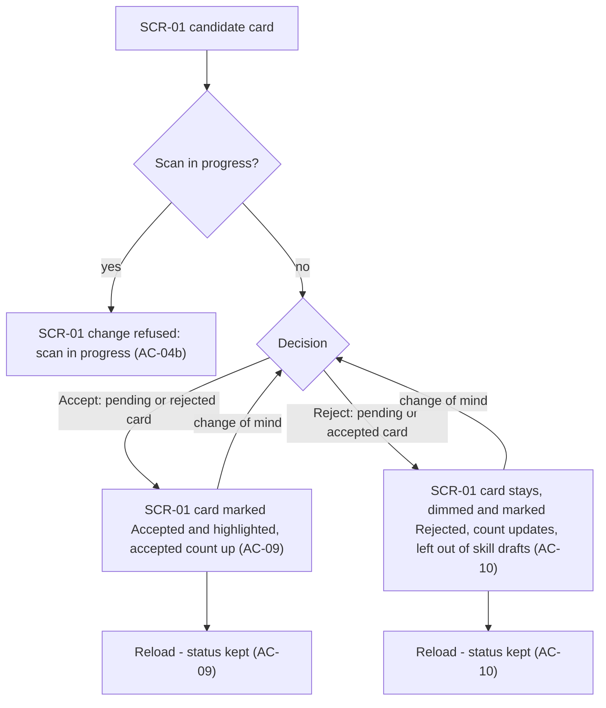
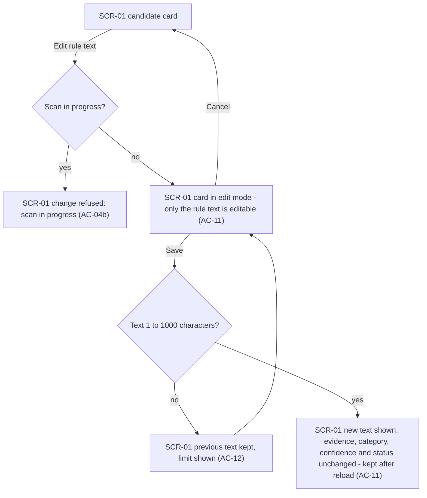
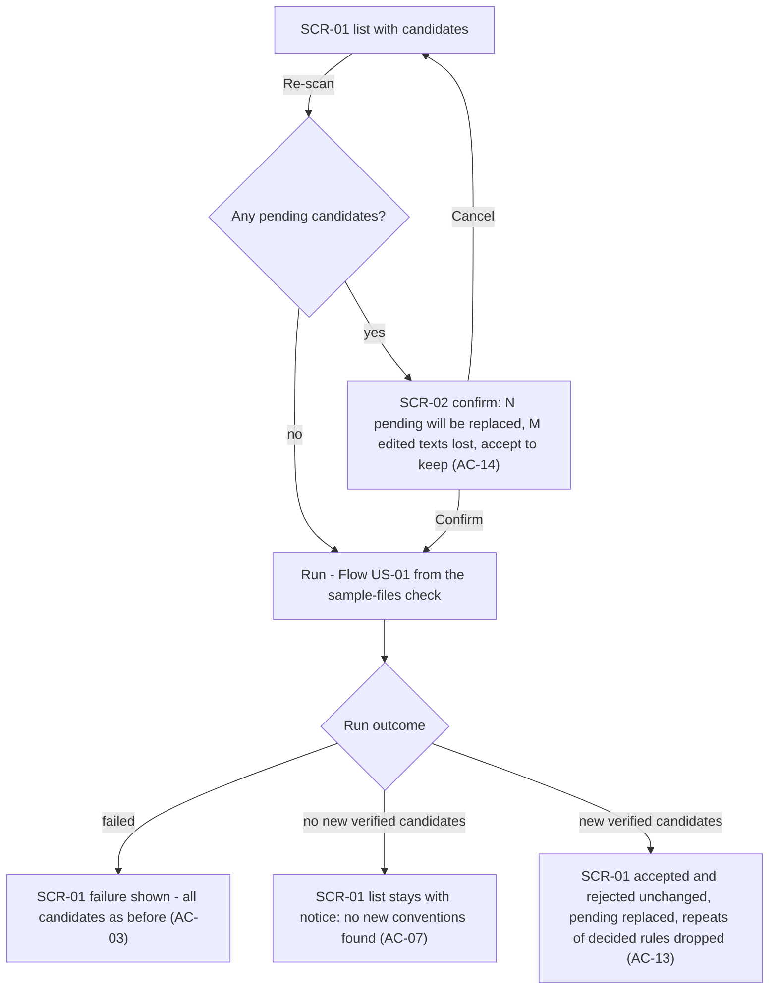
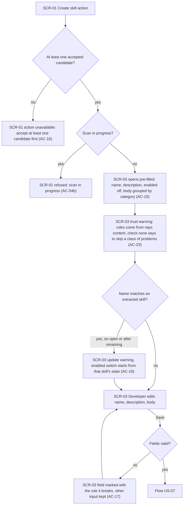
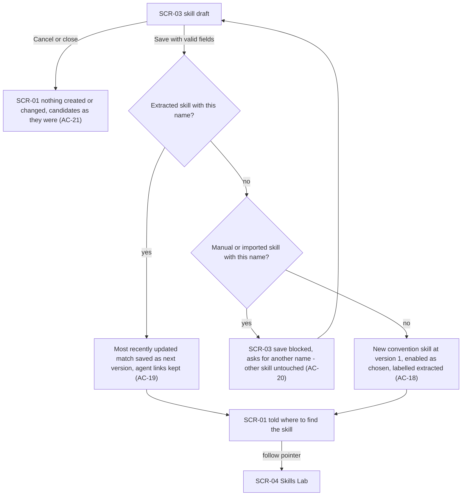
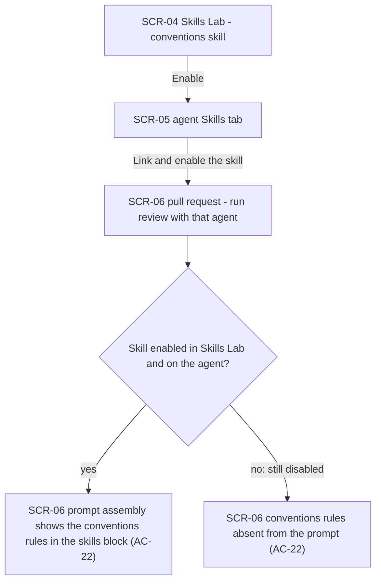

# UX flows — conventions-extractor

> User flows for every UI-touching §4 user story of [spec.md](./spec.md), produced by `ux-flows`
> (after `clarify`, before `design`) and read by `design` (evidence for the target-surface +
> UI-architecture decisions), `sequences` (UI-driven flows align on SCR ids), `screens` (details
> every inventory row) and `plan-tests` (the e2e-through-UI paths). Glossary: [CONTEXT](./CONTEXT.md).
> Flow altitude only — screen states, components and layout belong to `screens`.

## Platform decisions

- **Posture:** desktop-first — `docs/design-system.md` does not exist yet; chosen by the owner
  (2026-11-25) because DevDigest is a local developer tool used on a laptop/desktop screen next to
  the code. Narrow screens must not break, but are not optimised.
- **Navigation:** the Conventions page is per repo and is reached from the sidebar's Conventions
  entry while a repo is selected; it sits under Skills Lab in the breadcrumb.
- **Modality:** the Re-scan confirmation and the skill draft («Create skill from conventions») are
  dialogs over the Conventions page, not separate pages — closing either returns to the page with
  nothing changed. Editing a rule text happens in place on its card.
- **Waiting:** extraction runs while the Developer stays on the page (no background job, no
  notification elsewhere). If they leave and come back during a run, the page shows the run still
  in progress.
- **Hand-off to existing surfaces:** after saving, the Developer continues in existing screens —
  Skills Lab (enable the skill), the agent's Skills tab (link it), a pull request review (see it
  applied). This feature adds no new screens there.

## Screen inventory

| ID | Screen | Purpose | Entry | Exit |
|---|---|---|---|---|
| SCR-01 | Conventions page (per repo) | Run extraction, review candidates with evidence, accept / reject / edit them, start a re-scan or skill assembly | Sidebar Conventions entry with a repo selected; the «Back» from SCR-02 / SCR-03 | SCR-02 (Re-scan with pending candidates), SCR-03 (Create skill), sidebar |
| SCR-02 | Re-scan confirmation dialog | Confirm that N pending candidates (M of them with edited text) will be replaced | Re-scan on SCR-01 while pending candidates exist | SCR-01 (cancel, or confirm → scanning) |
| SCR-03 | Create skill from conventions dialog | Review and edit the drafted conventions skill, see the trust warning and the update warning, save or discard | Create skill on SCR-01 (≥ 1 accepted candidate) | SCR-01 (cancel / close / after save), SCR-04 (follow the «where to find it» pointer) |
| SCR-04 | Skills Lab (existing) | Find the saved skill labelled as extracted and enable it | Pointer after save on SCR-03; sidebar Skills | SCR-05 |
| SCR-05 | Agent page, Skills tab (existing) | Link the conventions skill to a reviewer agent and enable it there | Sidebar Agents → an agent | SCR-06 |
| SCR-06 | Pull request review and its prompt assembly (existing) | Run a review with the agent and see the conventions rules in its skills block | Repo pull requests → a pull request | — |

## Flows

### Flow: US-01 — Run conventions extraction

From the Conventions page the Developer runs extraction. A repo from another workspace behaves as
if it doesn't exist. A repo with no sample files is blocked before any model is asked, with the
reason (not indexed yet, or nothing to analyse). A second run on the same repo, from another tab or
a double click, is refused. Otherwise the page shows the scanning state, and accept, reject, edit
and Create skill are refused until the run ends. If the model fails, times out or answers
something unreadable, or the server restarts, the page shows the failure in plain words and the
earlier candidates stay. On a readable answer, the system quietly fixes or drops bad candidates
(over-long fields cut, incomplete ones dropped, unverified evidence or credentials dropped, at most
20 kept). If nothing survives, the empty state says no convention could be backed by evidence.
Otherwise the verified candidates appear as pending.

### Flow: US-02 — Review candidates with evidence

The Developer opens the Conventions page of a repo from the sidebar. Another workspace's repo
behaves as not found. A repo with no candidates shows the empty state with a Run extraction action,
which leads into the US-01 flow. A repo with candidates shows the header (repo name, sample files
analysed by the last successful run, how long ago, accepted out of total) and one card per
candidate with its rule, category, status, evidence file and line range, quoted fragment and
confidence. If a scan is running, the Developer can look but not change anything; otherwise they
move on to curating.

### Flow: US-03 — Accept or reject a candidate

On a candidate card the Developer accepts or rejects. During a scan the change is refused. Accepting
a pending or rejected card marks it Accepted and highlighted and raises the accepted count.
Rejecting a pending or accepted card keeps it in the list, dimmed and marked Rejected, updates the
count and leaves it out of any skill draft. Either decision can be reversed from the same card, and
both survive a page reload.

### Flow: US-04 — Edit a candidate's rule text

The Developer starts editing a card's rule text; during a scan this is refused. In edit mode only
the rule text can change — evidence, category and confidence are read-only. Cancel returns to the
card as it was. Saving an empty or over-long text keeps the previous text and shows the allowed
length, and the Developer can fix it. A valid save shows the new text, keeps everything else on the
card as it was, and survives a reload.

### Flow: US-05 — Re-scan the repo

From a page that already has candidates the Developer clicks Re-scan. With no pending candidates
the run starts straight away. With pending ones, a confirmation dialog first says how many pending
candidates will be replaced and how many of them have edited text that will be lost, and that
accepting a candidate keeps it; cancelling changes nothing. The run then follows the US-01 flow
(including the blocked, refused and scanning branches). If it fails, every candidate stays as it
was. If it finds nothing new, the list stays and a notice says so. Otherwise accepted and rejected
candidates are untouched, the pending ones are replaced, and new candidates that repeat a decided
rule (current or original text) are dropped.

### Flow: US-06 — Assemble a skill from accepted candidates

The Create skill action on the Conventions page is unavailable, with an explanation, until at least
one candidate is accepted, and refused while a scan runs. Otherwise the skill dialog opens: it says
how many accepted conventions it was built from and from which repo, and is pre-filled with the
name `repo-conventions`, a description, the enabled switch off, and a body grouped by category. It
always shows the trust warning. If the name (as opened, or after the Developer renames it) matches
an existing extracted skill, the dialog warns that that skill will be updated to a new version and
sets the enabled switch from that skill's current state. The Developer edits freely; on save, an
empty, non-slug or over-limit field is marked with its rule and everything else they typed is kept.
Valid input continues into the US-07 save flow.

### Flow: US-07 — Save or discard the conventions skill

In the skill dialog, Cancel or closing the dialog changes nothing and returns to the Conventions
page. Saving checks the name (ignoring case and surrounding spaces): if an extracted skill already
has it, the most recently updated one gets a new version with the new name, description and body,
and its agent links stay. If only a manual or imported skill has it, the save is blocked and the
Developer is asked for another name. If no skill has it, a new convention skill is created at
version 1, enabled or not as the switch shows, and labelled extracted. After either save the
Developer is told where to find the skill and can go to Skills Lab.

### Flow: US-08 — Apply the conventions in reviews

In Skills Lab the Developer enables the conventions skill, then on a reviewer agent's Skills tab
links it and enables it there, then runs a review on a pull request with that agent. If the skill
is enabled in both places, the run's prompt assembly shows its rules in the skills block like any
other skill. If it is still disabled, its rules are not in the prompt. All three screens already
exist; this flow only connects them.

## AC coverage

| AC | Shown by | Notes |
|---|---|---|
| AC-01 | Flow US-01 → «list of pending candidates» | The model named in the run log is not visible in the UI; asserted via the log |
| AC-02 | Flow US-01 → «run blocked» branch | |
| AC-03 | Flow US-01 → «extraction failed»; Flow US-05 → «failed» | |
| AC-03b | Flow US-01 → system node «trims, drops» | System-side; nothing extra is shown to the Developer |
| AC-04 | Flow US-01 → «refused: already running» | |
| AC-04b | Flows US-01 (scanning), US-02, US-03, US-04, US-06 → «refused: scan in progress» | |
| AC-05 | Flow US-01 → system node «drops unverified» | System-side; the visible effect is that only verified candidates appear |
| AC-06 | Flow US-02 → header and cards nodes | |
| AC-07 | Flow US-01 → empty state after a run; Flow US-02 → empty state; Flow US-05 → «no new conventions» notice | |
| AC-08 | Flows US-01 and US-02 → «Not found» | Also applies to change and assemble actions; same branch, not redrawn |
| AC-09 | Flow US-03 → Accept branch | |
| AC-10 | Flow US-03 → Reject branch | |
| AC-11 | Flow US-04 → edit mode and valid save | |
| AC-12 | Flow US-04 → invalid save branch | |
| AC-13 | Flow US-05 → «new verified candidates» | |
| AC-14 | Flow US-05 → SCR-02 and the «no pending» shortcut | |
| AC-15 | Flow US-06 → SCR-03 opens pre-filled | |
| AC-16 | Flow US-06 → «action unavailable» | |
| AC-17 | Flow US-06 → «field marked» loop | |
| AC-18 | Flow US-07 → «new convention skill» | |
| AC-19 | Flow US-06 → update warning; Flow US-07 → «next version» | |
| AC-20 | Flow US-07 → «save blocked» | |
| AC-21 | Flow US-07 → Cancel or close | |
| AC-22 | Flow US-08 → both branches | |
| AC-23 | Flow US-06 → trust warning node | |
| AC-24 | Flow US-01 → system node «drops credential-bearing» | System-side; the visible effect is that no credential ever appears on a card |
